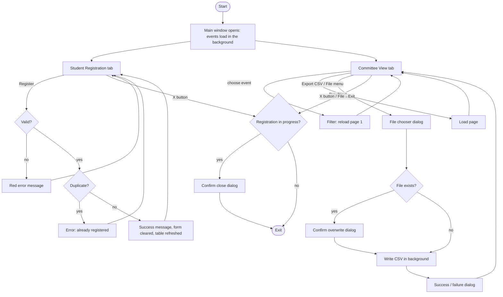
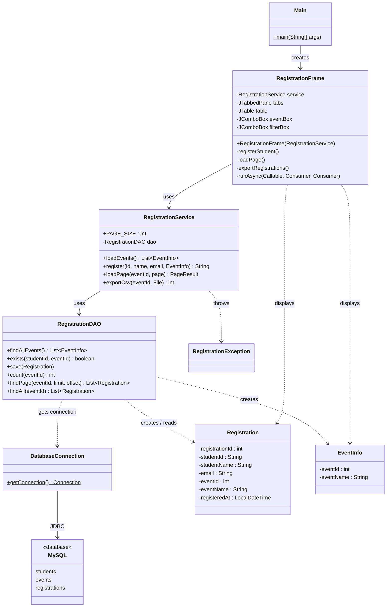

# Task 6 – Design Challenge (K5 – Evaluate): Campus Event Registration Desktop Application
**Student:** Lakshmi Devi J | **Register No:** 192524300 | Java 17+ · Swing · JDBC · MySQL 8

## Stage 1 – Interpret the Problem (2 marks)

**Users:** (1) *Student* – registers for events using a form (in practice a volunteer/kiosk operator enters the data). (2) *Committee member (admin)* – views all registrations, filters by event, exports the list.

**Screens:** (S1) Student Registration form; (S2) Committee View (table + filter + paging + export); dialogs: export file chooser, confirm-overwrite, export success/failure, About, confirm-close.

**Data:** `students(student_id PK, name, email)`, `events(event_id PK, event_name, event_date, venue)`, `registrations(registration_id PK, student_id FK, event_id FK, registered_at, UNIQUE(student_id, event_id))`.

**Rules and testable requirements**

| ID | Requirement (testable statement) |
|---|---|
| R1 | Registering with valid student ID, name, e-mail and an event stores one row in `registrations` and shows "Registration successful…". |
| R2 | Empty student ID, empty name, an invalid e-mail or no event selected is rejected with a message naming the problem; nothing is stored. |
| R3 | A second registration of the same student for the same event is rejected with "Student already registered for this event." and the table still contains only one row for that pair (also enforced by the UNIQUE constraint). |
| R4 | The Committee View lists registrations in a JTable, one page (10 rows) at a time. |
| R5 | Selecting an event in the filter shows only that event's registrations; "All Events" shows all. |
| R6 | "Export CSV" writes the registrations (of the selected filter) to a chosen file and reports "Registration data exported successfully". |
| R7 | While data loads/saves, the window remains usable (can be moved, resized, tabs switched). |
| R8 | The window asks for confirmation before closing while a registration is being saved. |
| R9 | The application contains no hard-coded database password. |

## Stage 2 – Screen and Event Flow (2 marks)

**Screen S1 – Student Registration (JTabbedPane tab 1, GridBagLayout)**
```
┌ Campus Event Registration ───────────────────────────────────┐
│ File   View   Help                                           │
├──[Student Registration]──[Committee View]────────────────────┤
│   Student ID:    [______________]                            │
│   Student Name:  [______________]                            │
│   Email:         [______________]                            │
│   Event:         [-- Select an event ▼]                      │
│                  [ Register ] [ Clear ]                      │
│   Status: Registration successful / Error: …                 │
└──────────────────────────────────────────────────────────────┘
```
**Screen S2 – Committee View (tab 2, BorderLayout)**
```
┌ Filter Event: [All Events ▼]  [Refresh] [Export CSV] ────────┐
│ ┌──────────────────────────────────────────────────────────┐ │
│ │ ID │ Student ID │ Name │ Email │ Event │ Registered At   │ │  JTable in JScrollPane
│ │ …                                                        │ │
│ └──────────────────────────────────────────────────────────┘ │
│              [< Prev]  Page 1 of 3  [Next >]                 │
│ Status: 25 registration(s) found.                            │
└──────────────────────────────────────────────────────────────┘
```
**Menu bar (JMenuBar):** *File* → Export to CSV… (Ctrl+E), Exit · *View* → Student Registration, Committee View, Refresh · *Help* → About.

**Screen / dialog flow**


## Stage 3 – Critical Design Decisions (2 marks)

| Concern | Where it happens | Reason |
|---|---|---|
| Input validation (empty, format, e-mail, event) | `RegistrationService.register()` (service layer) | Rules are independent of the GUI, testable without a window; the GUI only shows the message. |
| Duplicate check | **Two levels:** `RegistrationService` → `RegistrationDAO.exists()` for a friendly message, **and** the `UNIQUE(student_id, event_id)` database constraint (error code 1062 mapped to the same message). | The check-then-insert alone has a race condition (two operators saving at the same instant); the constraint guarantees correctness. |
| Database access | Only `RegistrationDAO` (JDBC, `PreparedStatement`, try-with-resources); connection from `DatabaseConnection`. | No SQL in the GUI; SQL injection prevented. |
| Keeping long work off the Event Dispatch Thread | `RegistrationFrame.runAsync()` wraps every service call in a **SwingWorker**: `doInBackground()` runs on a worker thread, `done()` updates components on the EDT. Used for loading events, registering, loading pages (filter/paging) and exporting. | The EDT paints and handles all events; a database call on it would freeze the window (see Task 1). Swing components are not thread-safe, so they must be updated only on the EDT – `done()` guarantees that. |
| Atomicity | `RegistrationDAO.save()` – student upsert + registration insert in one transaction (`commit` / `rollback`). | No student row without a registration on failure. |
| Credentials | Environment variables `DB_URL`, `DB_USER`, `DB_PASSWORD`. | Nothing secret in source control. |
| Large data | Paging (`LIMIT ? OFFSET ?`) – only one page in memory. | See the alternative analysis. |

## Stage 4 – Classes and Handlers (4 marks)

### Class diagram (Mermaid)

**Layering:** `Main → RegistrationFrame (GUI) → RegistrationService (business rules) → RegistrationDAO (JDBC) → DatabaseConnection → MySQL`. Each layer only knows the layer immediately below it. The model classes (`Registration`, `EventInfo`) travel between layers.

**How to turn the Mermaid diagram into an image**
1. Online: open <https://mermaid.live>, paste the code between the ```mermaid fences, then *Actions → PNG* (or SVG) and save into `Task06/screenshots/class_diagram.png`.
2. VS Code: install the extension *Markdown Preview Mermaid Support*, open this file, press Ctrl+Shift+V (preview), take a screenshot of the diagram (Win+Shift+S).
3. GitHub: the diagram renders automatically when you open this `.md` file on github.com – screenshot it.
4. Command line (needs Node.js): `npx -p @mermaid-js/mermaid-cli mmdc -i diagram.mmd -o class_diagram.png`.

### Pseudocode – Register action
```
ALGORITHM  RegisterAction
EVENT      actionPerformed on registerButton
INPUT      studentIdField, nameField, emailField, eventBox
OUTPUT     success or error message in formStatus; table refreshed on success

BEGIN
 1. id ← trim(studentIdField.text);  name ← trim(nameField.text)
 2. email ← trim(emailField.text);   event ← eventBox.selectedItem
 3. registerButton.disable();  registrationInProgress ← TRUE
 4. formStatus ← "Saving registration…"
 5. START SwingWorker (background thread):
 6.      // ---- service layer: validate input ----
 7.      IF id is empty                       THEN FAIL "Student ID is required"
 8.      IF id does not match [A-Za-z0-9]{3,20} THEN FAIL "Student ID must be 3-20 letters or digits"
 9.      IF name is empty                     THEN FAIL "Student name is required"
10.      IF email is empty or not valid       THEN FAIL "Email address is not valid"
11.      IF event = NULL OR event.id ≤ 0      THEN FAIL "Please select an event"
12.      // ---- check duplicate ----
13.      IF dao.exists(id, event.id) THEN FAIL "Student already registered for this event"
14.      // ---- save registration (one transaction) ----
15.      TRY dao.save(id, name, email, event.id)
16.      ON duplicate-key error (1062) FAIL "Student already registered for this event"
17.      ON other SQL error            FAIL "Database error: …"
18.      RETURN "Registration successful"
19. ON COMPLETION (Event Dispatch Thread):
20.      registerButton.enable();  registrationInProgress ← FALSE
21.      IF succeeded THEN
22.           formStatus ← success message (green);  clear the form
23.           CALL LoadPage                      // refresh the table if needed
24.      ELSE formStatus ← "Error: " + reason (red)
25.      END IF
END
```

### Pseudocode – Filter action
```
ALGORITHM  FilterAction / LoadPage
EVENT      itemStateChanged(SELECTED) on filterBox  (also Prev, Next, Refresh)
INPUT      filterBox, currentPage, PAGE_SIZE = 10
OUTPUT     JTable showing the selected event's registrations

BEGIN
 1. IF event came from filterBox THEN currentPage ← 0
 2. selected ← filterBox.selectedItem               // read selected event
 3. eventId ← 0 IF selected is "All Events" ELSE selected.id
 4. tableStatus ← "Loading…"
 5. START SwingWorker (background thread):
 6.      total ← SELECT COUNT(*) … WHERE (eventId = 0 OR event_id = eventId)
 7.      rows  ← SELECT … JOIN … WHERE (eventId = 0 OR event_id = eventId)
 8.               ORDER BY registration_id LIMIT 10 OFFSET currentPage × 10   // query database
 9.      RETURN (rows, total)
10. ON COMPLETION (Event Dispatch Thread):             // update JTable
11.      tableModel.clear()
12.      FOR EACH row IN rows DO tableModel.addRow(row) END FOR
13.      pages ← max(1, ceil(total / 10))
14.      pageLabel ← "Page " + (currentPage+1) + " of " + pages
15.      prevButton.enabled ← (currentPage > 0)
16.      nextButton.enabled ← (currentPage < pages − 1)
17.      tableStatus ← total + " registration(s) found."
18.  ON ERROR: tableStatus ← error message (red)
END
```

## Stage 5 – Implementation and Demonstration (3 marks)

### Files
| File | Layer | Role |
|---|---|---|
| `src/Main.java` | start-up | creates DAO → service → frame on the EDT (`SwingUtilities.invokeLater`) |
| `src/RegistrationFrame.java` | GUI | JFrame, JTabbedPane, JPanel, JTextField, JComboBox, JTable, JMenuBar; SwingWorker helper; no SQL |
| `src/RegistrationService.java` | service | validation, duplicate rule, paging, CSV export |
| `src/RegistrationDAO.java` | data access | all JDBC (PreparedStatement, try-with-resources, transaction) |
| `src/DatabaseConnection.java` | data access | connection from environment variables |
| `src/model/Registration.java`, `src/model/EventInfo.java` | model | data carriers |
| `database/schema.sql` | database | tables, keys, UNIQUE constraint, sample data |

(`EventInfo.java` is one extra small model class beyond the structure listed in the brief, used to carry event id + name into the combo boxes.)

### Setup, compile and run (Windows 11, PowerShell, from `Task06`)
1. In MySQL Workbench open `database/schema.sql` → Execute. Check `SELECT * FROM events;` returns 4 rows.
2. Download **MySQL Connector/J** (platform independent ZIP) from <https://dev.mysql.com/downloads/connector/j/>, extract `mysql-connector-j-8.x.x.jar` and copy it into `Task06\lib\`. *(This driver is the only external file; JDBC needs a driver. Do not commit the jar if you prefer – list it in the README.)*
3. Set the password for the current PowerShell window:
```powershell
cd Task06
$env:DB_PASSWORD = "your_mysql_root_password"
# optional: $env:DB_URL = "jdbc:mysql://localhost:3306/campus_events" ; $env:DB_USER = "root"
```
4. Compile and run:
```powershell
mkdir out -Force
javac -d out -cp "lib/*" src/model/*.java src/*.java
java -cp "out;lib/*" Main
```
Common problems: *"No suitable driver"* → jar missing from `lib`; *"Access denied"* → wrong `DB_USER`/`DB_PASSWORD`; *"Unknown database"* → schema.sql not executed; *"Communications link failure"* → MySQL service not running or a different port.

### Test cases (to demonstrate)

| # | Test | Steps | Expected result | Requirement |
|---|---|---|---|---|
| T1 | Valid registration | ID `192524300`, Lakshmi Devi J, `lakshmi@example.com`, *Dance Competition* → Register | Green "Registration successful: Lakshmi Devi J -> Dance Competition"; form cleared; Committee table gains a row | R1 |
| T2 | Invalid input | (a) all empty; (b) valid ID, empty name; (c) e-mail `abc`; (d) no event | (a) "Error: Student ID is required."; (b) "Student name is required."; (c) "Email address is not valid."; (d) "Please select an event." Each in red; no DB row | R2 |
| T3 | Duplicate registration | Repeat T1 exactly | Red "Error: Student already registered for this event."; table still has one row for the pair | R3 |
| T4 | View registrations | Open *Committee View* | JTable shows the sample + new rows, "N registration(s) found." | R4 |
| T5 | Filter | Filter = *Dance Competition* | Only rows with that event; count in status updates; select *All Events* → all rows return | R5 |
| T6 | Export | File → Export to CSV… (or button), save `registrations.csv` | Dialog "Registration data exported successfully"; opening the file shows header + rows | R6 |
| T7 | Responsiveness | Stop MySQL, press Refresh; try moving the window | Window remains movable; red error message appears after the connection attempt (proves SwingWorker) | R7 |
| T8 | Paging | Add more than 10 registrations (SQL below) → Next/Prev | "Page 2 of N"; Prev enabled | R4 |
| T9 | Close confirmation | Press X while "Saving registration…" is visible (hard to catch; may be demonstrated by explaining the code) | Confirm dialog | R8 |

SQL to add test data for T8 (MySQL Workbench):
```sql
USE campus_events;
INSERT INTO students (student_id, name, email)
SELECT CONCAT('TS', n), CONCAT('Test Student ', n), CONCAT('test', n, '@example.com')
FROM (SELECT 1 n UNION SELECT 2 UNION SELECT 3 UNION SELECT 4 UNION SELECT 5 UNION SELECT 6
      UNION SELECT 7 UNION SELECT 8 UNION SELECT 9 UNION SELECT 10 UNION SELECT 11 UNION SELECT 12) t;
INSERT INTO registrations (student_id, event_id)
SELECT student_id, 1 FROM students WHERE student_id LIKE 'TS%';
```

> **Honesty note:** the code compiles, and the validation rules (T2) were checked with a small test without a database. The database-dependent tests (T1, T3–T9) were **not** run by me – MySQL was not available – so the results above are *expected* outputs; run them and use your own screenshots as evidence.

## Alternative Concept and Complexity Analysis
**Approach A:** load *all* registrations into the JTable at once (`SELECT … ` without LIMIT, on one call).
**Approach B (implemented):** load one page at a time using `LIMIT ? OFFSET ?` in a `SwingWorker`.

Let **N** = 100 000 registrations, **p** = page size (10), row size ≈ 150–300 bytes of text data (≈ 0.5–1 KB per row including Java object, strings and `Vector` overhead in `DefaultTableModel`).

| Aspect | A – load everything | B – paging (`LIMIT/OFFSET` + `SwingWorker`) |
|---|---|---|
| Time to display first rows | O(N): the query transfers and the code builds N row objects (seconds for N = 100 000) | O(p) to transfer; the database must still walk past `OFFSET` rows, so page k costs O(k·p + p) with `ORDER BY` primary key (fast: index scan); for first pages ≈ O(p) |
| Total time to see *all* data | One load: O(N) | O(N/p) queries; each O(offset + p) → O(N²/p) in the worst case (deep pages). Large offsets get slower; a keyset method (`WHERE id > last_id LIMIT p`) would make each page O(p). |
| Memory in the application | **O(N)**: 100 000 rows × ≈ 0.5–1 KB ≈ **50–100 MB** in the JVM (may cause `OutOfMemoryError` at the default heap if rows are larger or N grows) | **O(p)**: 10 rows ≈ a few KB, independent of N |
| Memory in the JTable/Model | N rows, plus the row sorter | p rows |
| Responsiveness | Even when loaded in a SwingWorker, filling a `DefaultTableModel` with 100 000 rows and sorting/painting them lengthens the delay and, if done on the EDT, **freezes the window** for seconds | Each page loads in milliseconds; window stays responsive; user sees data immediately |
| Scalability | Breaks when N grows (memory, load time) | Scales: memory constant, time per page ≈ constant for early pages |
| Simplicity / features | Simplest code; sorting and searching the whole list in the table is instant after loading | Slightly more code (page state, count query); sorting by column only affects the current page unless done in SQL |
| Export | Already in memory | Needs a separate full query (`findAll`) – done in a background thread and streamed to the file |

**Evaluation:** with 100 000 registrations approach B is clearly better: constant memory O(p), an immediately responsive UI and a database that does the filtering. Approach A is acceptable only for a few hundred or thousand rows. The cost of B is more code and slower deep paging; the keyset pagination or filtering with an index on `event_id` addresses this. The `COUNT(*)` for the page label is O(N) in the worst case without an index, but is cheap with the `event_id` index created by the foreign key.

**Your own measurement (recommended):** insert 100 000 test rows and time `loadPage` (page 1) with `System.nanoTime()` versus loading all; record the numbers in your report (the PDF asks for measurements where possible).

## Screenshot evidence required
See `../SCREENSHOTS_CHECKLIST.md` (`Task06/screenshots/t6_*.png`) – each must be linked to the requirement it proves (R1–R8 above).

## Result
A layered Swing–JDBC application (GUI → Service → DAO → MySQL) with validation, a database-enforced duplicate rule, filtering, paging, CSV export and non-blocking database access through SwingWorker.
